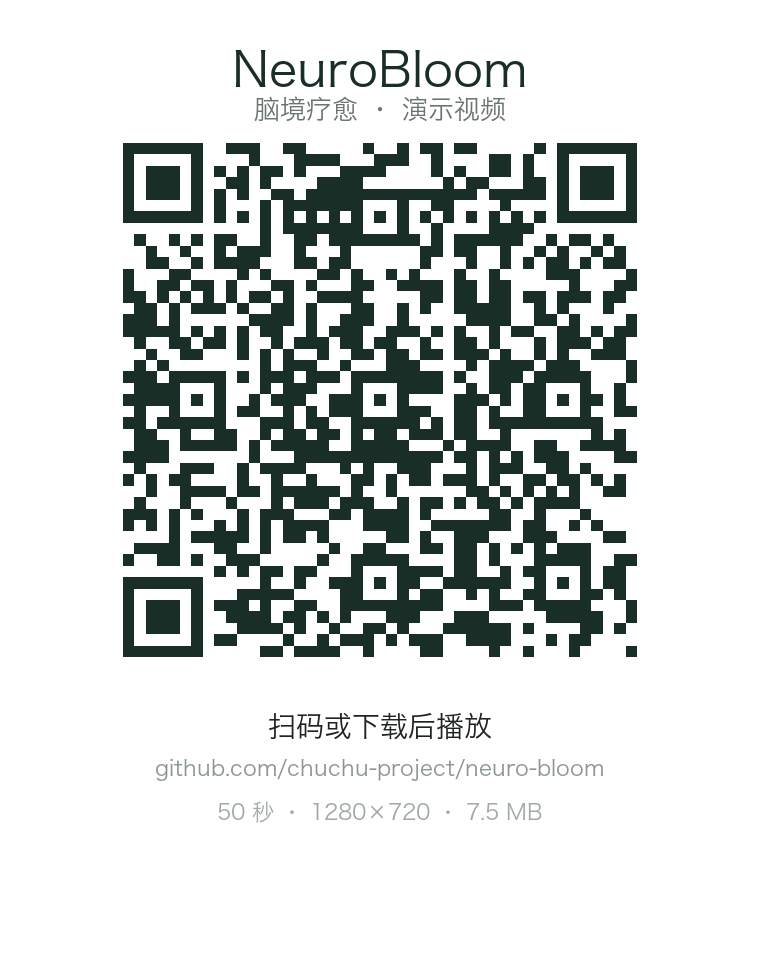

# NeuroBloom 脑境疗愈

卒中后居家康复的脑电闭环训练与随访智能体。

用一台 16 通道脑电设备，把使用者的实时状态翻译成一座会变亮、变暗、雾气聚散的
三维花园；治疗师在控制台看到训练完成情况、脑电指标走势与随访风险分层。
**方案验证阶段，不做诊断，不做疗效结论。**

一句话链路：

```
脑电采集 → 相对本人基线算 α/β 指数 → 四个画面参数 → Unity 花园 → 会话报告与随访
```

## 演示



扫码，或直接打开 [neurobloom-demo.mp4](docs/assets/neurobloom-demo.mp4)（50 秒 · 1280×720 · 7.5 MB）。

画面是 Unity 实时渲染的帧流，不是截图拼接：指数从 0.84 走到 0.96，花开、雾散、光照上升；
第 30 秒起右下角出现呼吸引导（吸 4 秒 / 呼 6 秒）。演示用合成样本，实际部署时全程带
`SIMULATED` 水印。

## 文档（先看这五份）

| 文档 | 回答什么问题 |
| --- | --- |
| [项目提案](docs/proposal.md) | 谁的问题、为什么现在做、做到什么程度 |
| [需求文档](docs/prd.md) | 做什么功能、每条的验收标准、不做什么 |
| [技术设计](docs/tech-design.md) | 怎么搭、为什么选这些技术、坏了怎么降级 |
| [验证结果](docs/verification.md) | 每条需求做到没有、证据是什么、还差什么 |
| [决策记录](docs/decisions.md) | 关键选择的备选项、结论、事后怎么检查 |

辅助材料：[AGENTS.md](AGENTS.md)（给 AI 助手的项目约束）。

## 现在能做什么

| 能力 | 说明 |
| --- | --- |
| 设备连接与信号质量 | 16 路波形 25 帧/秒，每路显示贴顶比例与 µVrms，接触好坏一眼可见 |
| 一人一基线 | 开头 60 秒定基线，之后只看相对变化，换人重新标定 |
| α/β、β/θ 判定 | 4 秒窗、2 秒步、因果平滑；同一份数据回放两次序列一致 |
| 三维花园反馈 | 花开、雾散、光照、水晶四个参数随指数单调变化 |
| 训练报告 | 走势、通道质量、频带构成、左右不对称，一页 HTML |
| 随访量表 | PHQ-2/9、GAD-7 计分与分层，第 9 题红线，导出 CSV |
| 演示模式 | 手动开启，全程 `SIMULATED` 水印，关掉立刻回到空态 |

## 怎么跑起来

```bash
bash setup/macos-dev-setup.sh
source .venv/bin/activate
cp .env.example .env          # 书生 API Key，不填则引导语走本地兜底
bash start.sh                 # bridge + 采集 + 引导语；bash stop.sh 停
```

浏览器打开 `http://127.0.0.1:8765/app.html`。没有采集板时点「演示（非脑电）」，
链路可跑通，但画面带水印。

双击 `打开演示.command` 可一键回放已录制的 BDF，每 10 秒换一轮氛围，开局 3 轮为不干预对照。

## 目录结构

| 路径 | 作用 |
| --- | --- |
| `eeg_service/` | 采集（真设备 / 合成板 / 文件回放） |
| `analysis/` | 判定内核、会话报告、量表、趋势 |
| `strategy/` | 演示策略层，按轮次调制氛围（含不干预对照） |
| `bridge/` | WebSocket 桥（:8765），三方唯一交汇点 |
| `agent_service/` | 大模型生成引导语，只出文本，不写画面参数 |
| `tools/` | 延迟实测、重复性、状态区分度、自评录入 |
| `UnityVR/` | Unity 工程，接脑电的脚本在 `Assets/Scripts/` |
| `docs/` | 设计文档、技术参考、演示资产 |
| `sessions/` | 会话记录与报告，本地数据，不进仓库 |

## 团队分工

| 成员 | GitHub | 负责 |
| --- | --- | --- |
| 楚景越 | [@chuchu-project](https://github.com/chuchu-project) | 软件设计与实现（采集、判定、桥接、控制台）、3D 场景与推流、技术文档 |
| 张喻嫣 | [@chefzs929-prog](https://github.com/chefzs929-prog) | 脑电数据采集与实验（戴帽与电极布置、基线标定、实验记录、信号质量排查） |

贡献以 issue / PR / commit 中的 `@username` 记录，规则见 [CONTRIBUTING.md](CONTRIBUTING.md)。

## 边界与限制

- **不做诊断**，不给治疗建议，所有指标写「参考」
- **未做临床验证**，未接入真实患者数据，现有验证限于健康成人的链路自洽检查
- **未做患者/治疗师访谈**，用户需求来自公开文献与场景推演，已在提案中标注为假设
- 左右不对称是同源代理指标，**不是 F3/F4 的 FAA**，不用于情绪判断
- 演示数据可开可关，开启时全程水印

## 技术细节

### 判定只有一处

α/β 绝对值因人而异（同一人不同时段能差 3 倍），所以判定不看绝对值，只看相对自己的基线：

```
relax = clamp(0.5 + 0.5 * log2(score / baseline), 0, 1)
```

0.5 倍基线→0，1 倍→0.5，2 倍→1.0。`analysis/relax_axis.py` 是唯一实现，
现场用「因果平滑 + 开头 60 秒定基线」，回放用「居中平滑 + 自动挑最干净的一段」。

### 跨端契约

`world_params` 的四个键 `sunlight` / `fog` / `bloom` / `crystal`（0~1）不可改名，
改名 Unity 全收 0。画面参数只由脑电链路写入，`agent_service` 只输出引导语文本。

### 数据流

```
eeg_service ──(ws :8765/ws/eeg)──► bridge ──(ws :8765/ws/world)──► UnityVR
      │                                  ▲
      └── strategy/ 调制的四键 ───────────┘
agent_service（引导语，可选）──────────────┘
```

### 延迟口径

```bash
./.venv/bin/python tools/latency_probe.py --seconds 40
```

本机演示样本实测：攒窗 4000 ms / 分析 1.0 ms / 传输中位 2.3 ms（95 分位 3.7）。
**不要对外讲「延迟低于 100 ms」**，口径见 [延迟实测](docs/neurobloom-latency.md)。

### 更多技术参考

| 文档 | 内容 |
| --- | --- |
| [脑电设备上手](docs/neurobloom-eeg-setup.md) | ExpandableEEG 16 通道接线与设置 |
| [接真设备（Mac）](docs/接真设备-Mac.md) | MacBook 接入与实验数据采集 |
| [设备清单](docs/neurobloom-equipment-list.md) | 演示与演示外两套配置 |
| [训练会话报告](docs/neurobloom-session-report.md) | 报告怎么生成、怎么讲 |
| [验证方案](docs/验证方案.md) | 三层验证协议与结论口径 |
| [对标分析](docs/neurobloom-benchmark.md) | 与同类方案的差距与补齐路径 |
| [复制路径](docs/neurobloom-replication-path.md) | 换一台机器怎么搭起来 |

## 说明

- 无真脑电设备时，控制台点「演示（非脑电）」跑通整条链路；演示样本一律标注，不当真实数据用。
- 接真设备用环境变量切换，不改代码（见 [接真设备（Mac）](docs/接真设备-Mac.md)）。
- 全部密钥走 `.env`，不提交仓库。
