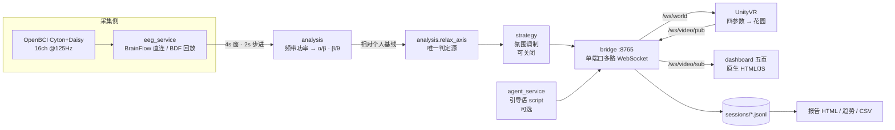

# 技术设计（Technical Design）

> 脑境 NeuroBloom · 结构、技术栈、数据格式与失败降级

> 版本 v1.0 · 2026-11-12
> 关联：[PRD](prd.md) 的 FR-01–FR-07 · [验证结果](verification.md)

## 1. 系统结构



**职责边界**：`analysis/relax_axis.py` 是判定的唯一实现，`eeg_service/main.py`、`replay_service.py`、`live_state_gui.py` 都调用它，不各写一份。`bridge` 是三方唯一交汇点，负责限流、广播与会话落盘，不做任何算法。

## 2. 技术栈与理由

| 层 | 选择 | 理由 | 更简单的方案为什么不选 |
| --- | --- | --- | --- |
| 采集 | Python + BrainFlow | 官方支持 Cyton/Daisy，BDF 回放与实时同一条接口 | 直接读串口需自行实现协议与丢包处理 |
| 判定 | Python（numpy + scipy） | 与采集同进程，避免跨语言序列化 | — |
| 通信 | `websockets` 单端口多路 | 一条连接承载状态/波形/视频，部署简单 | HTTP 轮询延迟高、视频不适合 |
| 前端 | 原生 HTML/CSS/JS | 无构建步骤，评审机器上直接打开 | 引入框架会增加环境依赖，收益不足 |
| 3D | Unity（C#） | 目标形态是 VR，场景与光效需要实时渲染 | Three.js 无法覆盖后续 VR 端 |
| 大模型 | 外部 API（可选） | 只生成引导语文本，失败可回退 | 本地模型体积与部署成本不划算 |

## 3. 数据

### 会话记录 `sessions/session-*.jsonl`（不进仓库）

每条状态一行，字段只增不改：

```json
{
  "ts": "2026-11-12T10:03:21.412",
  "relax": 0.72, "focus": 0.55,
  "label": "relaxed",
  "bands": {"delta": 0.11, "theta": 0.18, "alpha": 0.31, "beta": 0.24, "gamma": 0.06},
  "lr": 0.04,
  "world_params": {"bloom": 0.72, "sunlight": 0.79, "fog": 0.28, "crystal": 0.8},
  "script": "……"
}
```

- `world_params` 四键是**跨端契约**：改名 Unity 就全部收 0。
- `bands` / `lr` / `focus` 为后续新增字段，旧版 Unity 不认识也不影响。

### 随访 `*.jsonl`（不进仓库）

量表条目按时间追加，含量表类型、各题得分、总分、分层、红线标记。

## 4. 判定实现

1. **预处理**：去直流 → 0.5–45 Hz 带通 → 通道质量（`Railed%`、`µVrms`）。
2. **频谱**：4 秒窗 Welch，频带积分得 δ/θ/α/β/γ 功率。
3. **比值**：`score = α/β`（放松轴）、`β/θ`（专注轴）。
4. **归一化**：相对本人基线 `b`，`relax = clamp(0.5 + 0.5·log₂(score/b), 0, 1)`。
   - 基线 = 前 60 秒内所有窗的中位数；现场用因果平滑，回放用居中平滑。
5. **平滑**：最近 5 窗（≈10 s）因果滑动平均，不使用未来数据。
6. **映射**：`bloom=r`、`sunlight=0.25+0.75r`、`fog=1−r`、`crystal=clamp((r−0.4)/0.4)`。
7. **分档**：`≥0.65` 放松、`≤0.35` 紧张、其余中间；天气 `≥0.66/≤0.34` 带 ±0.04 滞后。

全程确定性，无随机项、无在线学习，同一输入必得同一输出。

## 5. 失败模式与降级

| 失败 | 检测 | 行为 |
| --- | --- | --- |
| 无采集板 | 启动自检 | `/control/start` 返回 `blocked: no-board`，界面空态，不造数 |
| 通道质量差 | 合格通道 < 8 | 不下结论，显示原因 |
| Unity 断线 | WebSocket 断开 | 前端重连；Unity 退回默认参数，不崩溃 |
| 大模型不可用 | 请求超时/报错 | 使用预置引导语池（`pick_fallback`） |
| 桥接进程挂掉 | 心跳缺失 | 前端显示断开并提供重连，不静默重试 |
| 演示误用 | 演示开关 | 全程 `SIMULATED` 水印 + 橙色横幅，关闭即空态 |

## 6. 检查与验证

| 检查 | 命令 / 位置 | 判据 |
| --- | --- | --- |
| 板卡连通 | `analysis/check_board.py` | 16 路全部有信号 |
| 端到端延迟 | `tools/latency_probe.py` | 判定 4000 ms 为物理下限；传输中位 < 10 ms |
| 重复性 | `tools/reliability.py` | ICC(2,1) |
| 区分度 | `tools/state_probe.py` | 闭眼/睁眼 α 倍数、AUC |
| 回放确定性 | 同一 BDF 回放两次比对 | 指数序列逐点一致 |
| 无板行为 | 断开板卡启动 | 返回 `blocked`，界面无数字 |

## 7. 明确不适用的项

| 项 | 结论 |
| --- | --- |
| 鉴权 / 多租户 | 不适用：单机单治疗师，无远程多用户 |
| 数据库 | 不适用：会话为追加写文件，查询靠报告与趋势脚本 |
| 支付 / 微服务 / 云托管 | 不适用：本地演示场景，无对应需求 |

## 8. 已知技术债

- 左右半球分组写死为「前 8 路=左、后 8 路=右」，依赖接线顺序；换设备或改接线需重新确认。
- 8 通道设备下，合格通道门槛 8 会导致频繁"不下结论"，需按设备能力分级。
- Unity 构建产物与 Library 不入库，评审需自行打开工程或使用演示视频。
